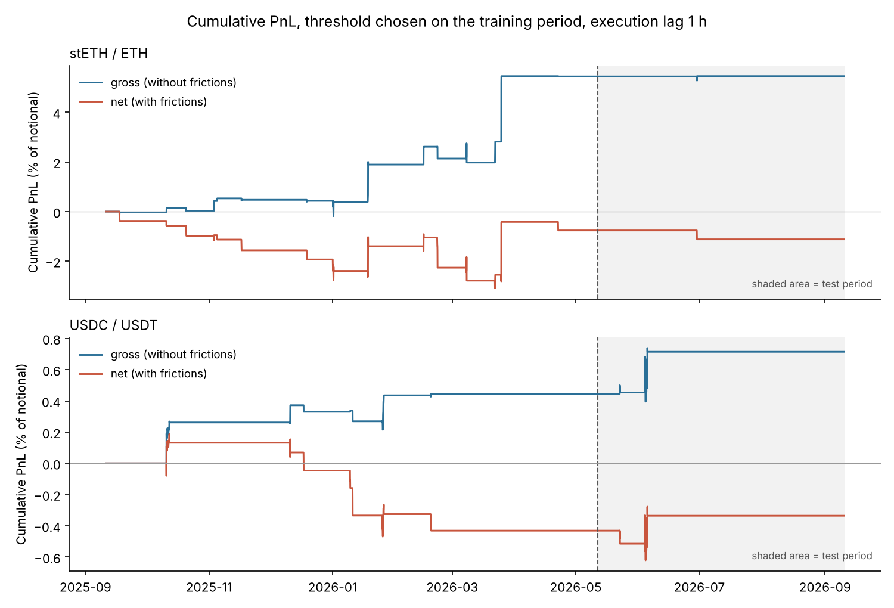
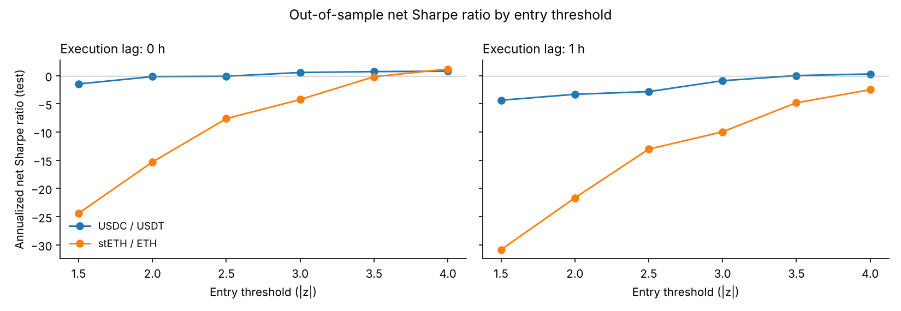

# Statistical Arbitrage on DeFi Pairs: Extensions of the OTT

End-to-end pipeline for a crypto *pairs trading* strategy: data acquisition,
cointegration, Ornstein-Uhlenbeck modelling, dynamic-band signal, return/CVaR allocation
and a backtest with realistic DeFi frictions.

**Universe**: stETH/ETH (liquid staking), USDC/USDT (stablecoins), AAVE/ETH (DeFi).
**Data**: CoinGecko API, hourly, Sept 2025 → Sept 2026 (8,736 points per asset).

## Key result

> Both cointegrated pairs show strong mean reversion **on paper** (gross Sharpe ratio of 2
> to 4), but **neither delivers a usable net return out of sample** once a realistic
> execution lag and trading frictions are taken into account.

Three findings, in the order in which they destroy performance:

1. **Execution lag.** The stETH/ETH spread has a half-life of about 2 hours: one hour after
   the signal, a large part of the deviation has already closed. Trading at the very price
   that triggered the signal (an implicit assumption of many backtests) strongly inflates
   the result. Over the training period, stETH/ETH gross PnL drops from +17.3% to +5.4%
   with a 1-hour lag.
2. **Frictions.** Pool fees, slippage and gas absorb the rest. The lower the entry
   threshold, the more trades, and the faster the net Sharpe ratio collapses (chart below).
3. **Out of sample.** The threshold chosen on the training period (|z| > 4) only generates
   1 to 2 trades over the test period: no statistical conclusion is possible.

AAVE/ETH is not cointegrated (ADF ≈ −1.7) and is excluded from step 2 onwards.





### Key figures (threshold |z| > 4, $100,000 of capital split equally)

| Pair | Lag | Period | Gross PnL | Net PnL | Net Sharpe | Trades |
|---|---|---|---|---|---|---|
| stETH/ETH | 0 h | training | +17.3% | +11.1% | 2.77 | 16 |
| stETH/ETH | 1 h | training | +5.4% | −0.8% | −0.28 | 16 |
| stETH/ETH | 1 h | **test** | +0.0% | **−0.4%** | −2.49 | 1 |
| USDC/USDT | 0 h | training | +1.5% | +0.6% | 1.48 | 7 |
| USDC/USDT | 1 h | training | +0.4% | −0.4% | −1.45 | 7 |
| USDC/USDT | 1 h | **test** | +0.3% | **+0.1%** | 0.30 | 2 |

Returns as a % of each line's notional, not annualized. Full detail in
`outputs/backtest_results.csv`.

## Methodology

| Step | Choice | Compared with the original paper |
|---|---|---|
| Split | 2/3 training (Sept 2025 → May 2026), 1/3 test (May → Sept 2026) | every parameter is estimated on the training period only |
| Hedge ratio | β = 1 for 1:1 pegged pairs, OLS otherwise | — |
| Cointegration | hand-written ADF test (numpy) + Ornstein-Uhlenbeck process | replaces static Engle-Granger; gives the half-life |
| Signal | z-score on an EWMA mean/standard deviation (window = 10 × OU half-life) | replaces fixed thresholds computed on the whole history |
| Execution | signal at t, trade at t + 1 h | the original trades at the signal price |
| Entry threshold | chosen on the training period among {1.5 … 4} | — |
| Allocation | max return/5% CVaR (falls back on minimum CVaR when all returns are negative) | replaces return/variance |
| Frictions | AMM fee tier, x·y=k slippage, log-normal gas in Gwei | replaces a flat 0.1% fee |

## Limitations

- **Price data**: CoinGecko prices are hourly multi-venue aggregates, not executable
  prices. Part of the hourly "mean reversion" measured is probably aggregation noise.
- **Liquidity**: without on-chain data, pool depth is proxied by 10 × the CoinGecko 24h
  volume (across all venues). This is a strong assumption; slippage is probably
  underestimated for stETH and overestimated for USDC.
- **Gas**: simulated (log-normal centred on 25 Gwei), not historical.
- **Small test sample**: 1 to 2 trades per pair over 4 months at the selected threshold.
- **Allocation**: since gas is a fixed USD cost, net returns depend on the notional; the
  optimization computes them at the equal-weight notional (approximation).

## Structure

```
.
├── data/                         # raw CoinGecko CSVs (timestamp_ms, price_usd, volume_usd)
├── outputs/                      # results (CSV) and figures, regenerated by run_all.py
└── src/
    ├── config.py                 # training/test split, execution lag, capital
    ├── fetch_coingecko.py        # 1. data acquisition
    ├── cointegration_ou.py       # 2. hedge ratio, ADF, Ornstein-Uhlenbeck
    ├── signal_generation.py      # 3. EWMA bands and state machine
    ├── sensitivity_frequency.py  #    entry threshold selection (training period)
    ├── backtest_engine.py        # 4. backtest with frictions, metrics by period
    ├── portfolio_optimization.py # 5. return/CVaR allocation
    ├── make_figures.py           #    README figures
    └── run_all.py                #    runs everything in order
```

## How to run

```bash
pip install -r requirements.txt
python src/run_all.py            # ~1 min; data is provided in data/
python src/fetch_coingecko.py    # optional: re-download the data (last 365 days)
```

To see the effect of the execution lag, change `EXECUTION_LAG_HOURS` in `src/config.py`.
